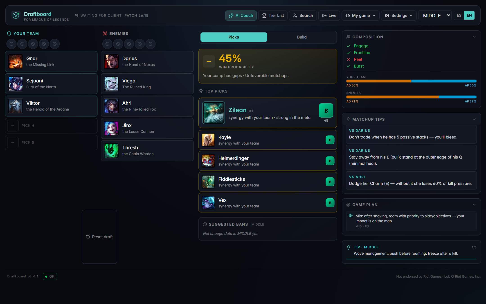
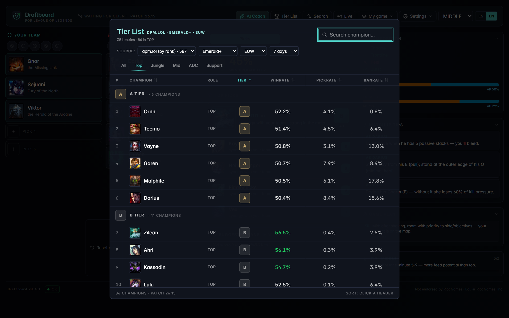

# Draftboard

[](https://github.com/Rafaellopezdelrio/draftboard/actions/workflows/ci.yml)
[](https://github.com/Rafaellopezdelrio/draftboard/releases)
[](LICENSE)

Pro-level draft advisor and AI coach for League of Legends.

A free, privacy-first desktop application that helps players from Iron to
Challenger climb solo queue. Champion-select suggestions tuned to your
mastery, full matchup grid with real win-rates per opponent, live in-game
overlay, post-game AI coaching, and per-bracket tier lists.

8 MB installer. All player data stays local (SQLite). All Riot API calls are
routed through a Cloudflare Worker proxy with edge caching — no per-user API
key required.



Champion select: the engine ranks your pool against the live draft, scores the
comp (engage / frontline / peel / burst, AD-AP split) and surfaces per-opponent
matchup tips.



Tier list: per rank bracket and region, with win-rate / pick-rate / ban-rate and
a pick-rate floor so small-sample champions don't fake their way into S tier.

## Features

### Champion select
- **Top Picks engine** — combines tier list + your mastery + draft context
  (counter / synergy / archetype fit). Splits into "Comfort + meta" (picks
  you actually know how to play) and "Meta puro" (strong picks you don't
  play yet). Unranked players get mastery weighted up to 35%.
- **Auto-apply runes + summoner spells** to the live LoL client (LCU).
  Spell coherence layer overrides op.gg's dominant pick when the champion's
  archetype warrants it (e.g. Galio mid → Flash+TP, not Flash+Ignite).
- **Counter detection** — full 62-entry matchup grid per (champion, role).
  Shows real WR% vs each opponent with sample sizes; the bad and the good
  separated so you actually see what beats you.

### Tier list
- **Per-bracket tier list** powered by dpm.lol — choose your exact rank
  (Iron → Challenger, 17 brackets) and region (EUW, KR, NA, etc).
- **Pick-rate filter** removes statistical noise: a champ in S+ tier must
  have at least 3% pickRate, not just a small-sample win streak. Genuinely
  meta picks (Vayne TOP in Challenger with 8% PR) stay at the top regardless
  of bracket volume.
- **op.gg fallback** with role-rate filter (drops Vayne TOP, Shaco SUP,
  etc. unless they're really played in that role).

### In-game (live)
- **Live game panel** via Riot's localhost:2999 API. Game timer, team
  scores, your gold/level, dragon and baron ETAs derived from kill events.
- Polls every 2s while in a game, drops to 10s between games.

### AI Coach
- **Multi-provider**: Groq (fast, free), Anthropic Claude (best reasoning),
  Google Gemini (free fallback).
- **Champion guides** generated on demand and cached locally.
- **Post-game analysis** calibrated to your rank — Iron-Bronze gets
  fundamentals, Master+ gets wave control and trade theory.
- **Bilingual (es / en)** with curated matchup tips for ~44 champions.

### Match scout & history
- Lookup any Riot ID, see masteries and recent matches.
- LCU integration auto-loads your rank for engine calibration.
- Trends panel: last 20-50 matches with detected patterns.

### Auto-update
- Signed Tauri auto-updater pulls new releases from GitHub. One click to
  install and relaunch — no manual reinstall.

## Architecture

| Layer | Stack |
|---|---|
| Desktop shell | Tauri 2 (Rust + WebView2) |
| Frontend | React 19 + TypeScript + Vite 7 + Tailwind 4 |
| State | Zustand |
| Local DB | SQLite (`tauri-plugin-sql`) with versioned migrations |
| LCU bridge | Rust (`tokio-tungstenite`, WebSocket to local client) |
| Live game | Rust HTTP polling of `localhost:2999` |
| AI providers | Groq · Anthropic · Google Gemini |
| Riot/data proxy | Cloudflare Worker (edge cache, secret-injected auth) |
| Update channel | Tauri updater + GitHub Releases + signed manifest |

## Privacy & policy compliance

- All match data stays in `%APPDATA%\com.draftboard.app\lol-draft-advisor.db`.
- The proxy is stateless — no backend database, no analytics, no telemetry
  beyond Sentry crash reporting (which scrubs PII before send).
- We only fetch data for the local user or Riot IDs they explicitly search.
- **No process memory reads. No client modification. No automated in-game
  actions.** Fully compliant with Riot's third-party developer policies.
- Auto-apply runes/spells uses Riot's officially documented LCU endpoints
  (same as Blitz, Mobalytics, Porofessor in-game).

## Install

Download the latest signed installer from the
[Releases page](https://github.com/Rafaellopezdelrio/draftboard/releases).

- **NSIS** (~3 MB): `Draftboard_<version>_x64-setup.exe` — recommended
- **MSI** (~4 MB): `Draftboard_<version>_x64_es-ES.msi` or `_en-US.msi`

Windows SmartScreen may warn the binary is unsigned by an EV cert. Click
"More info" → "Run anyway". Future releases will be code-signed once we
finish the EV cert process.

Once installed, the app auto-updates from this same GitHub Releases page —
you'll see a banner inside the app when a new version ships.

## Development

```bash
git clone https://github.com/Rafaellopezdelrio/draftboard.git
cd draftboard
npm install
npm run tauri dev
```

Tests:

```bash
npm test               # 961 unit/integration tests (117 files)
npm run test:e2e       # Playwright smoke suite
npm run check:all      # typecheck + unit tests + clippy + rustfmt
```

Regenerate the README screenshots (needs `npm run dev` running on 1420):

```bash
node scripts/screenshots.mjs
```

## Quality gates

Every push to `main` and every PR runs [CI](.github/workflows/ci.yml). All of
these are blocking — nothing merges around them:

| Gate | What it catches |
|---|---|
| `npm audit --omit=dev --audit-level=high` | known advisories in shipped deps |
| `cargo audit` (RustSec) | advisories in the Rust/network crate tree |
| `tsc --noEmit` on Linux **and** Windows | case-sensitivity bugs a single OS hides |
| `eslint` (react-hooks) | rules-of-hooks + stale-closure deps |
| `vitest` (961 tests) | engine, services, stores, parsers |
| Playwright smoke (8 tests) | the app actually boots and renders |
| `vitest --coverage` | coverage may not regress below baseline |
| `scripts/bundle-check.mjs` | chunk-size budget (hard fail over 650 KB) |
| `cargo clippy -D warnings` + `cargo fmt --check` | Rust lint + format |

Testing philosophy — every user-visible bug becomes a regression test before
the fix lands — is written down in [`TESTING_POLICY.md`](TESTING_POLICY.md).

Build production installer:

```bash
npm run tauri build
# Output: src-tauri/target/release/bundle/nsis/Draftboard_*_x64-setup.exe
```

See [`docs/releasing.md`](docs/releasing.md) for the release flow
(version bump, tag, GitHub Action publishes signed installer).

## Roadmap

- In-game transparent overlay (currently a separate window)
- Auto-scout the 10 players in your lobby (Porofessor-style)
- Item-set sync to the in-game shop
- Pro builds (Faker's Aatrox specifically) via Leaguepedia
- Cerebras as a 4th AI provider for redundancy

## License

MIT
